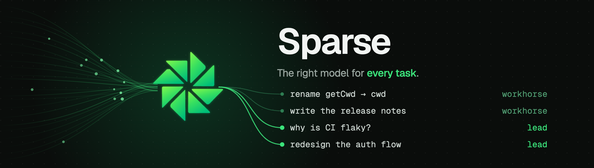
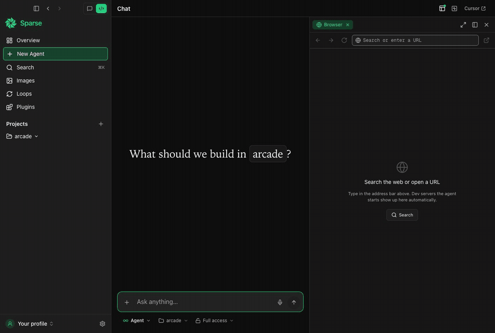

<p align="center">
  
</p>

<p align="center">
  
  
</p>

<p align="center">
  <strong>An AI assistant and coding agent that picks the right model for every task.</strong>
</p>

<p align="center">
  Sparse sits between you and every AI model you have access to. Ask it a question and it answers;
  point it at a project and it plans the work, turns each change into a reviewable diff, checks it, and learns
  what works on your repo. Behind the scenes it routes each step to the model that fits it: fast, cheap
  models for routine work, frontier models for the hard parts. You stop choosing models. You just build.
</p>

<p align="center">
  
  <br />
  <sub>One prompt in the desktop app: planned, built, verified, and previewed. Real run, fast-forwarded.</sub>
</p>

<p align="center">
  <a href="https://github.com/Code-Router/CodeRouter/releases/latest"><strong>Download</strong></a> ·
  <a href="#quick-start">Quick start</a> ·
  <a href="https://github.com/Code-Router/CodeRouter/issues/new/choose">Report a bug</a>
</p>

---

## Why Sparse

- **One assistant, every model.** One OpenRouter key gives Sparse the whole catalog: Anthropic, OpenAI, Google, DeepSeek, Moonshot, Z.ai and more. Its own agent runs the work, so there's no other tool to install.
- **Chat or code.** Questions, emails, summaries and research get one well-routed answer. Coding tasks get a full pipeline: plan, edit, validate, review. "Work on a copy" drafts edits in a git worktree; Ask first and Full access edit your files in place. Shell commands the agent runs are not isolated.
- **Spend where it matters.** Most of a coding session isn't hard. Renames, boilerplate and "where is X?" go to fast, cheap models; deep reasoning, refactors and architecture get the frontier ones.
- **See every decision.** Each model pick is logged with its reason, and routing improves from the outcomes of your own runs.
- **A full desktop app.** Chats, plans, loops, sessions, cost tracking with a monthly budget, a built-in image studio, browser and terminal in one place.

## How it works

1. **Answer or work.** Every prompt is sorted into a conversation (wants an answer) or a task (wants changes to your project). Conversations get one well-routed reply.
2. **Plan.** For real work, a planner splits the prompt into sub-tasks and assigns each one a model, with quality floors for risky or architectural changes.
3. **Run and check.** Sub-tasks run in parallel with their own lean context. A step that fails its checks is retried on a stronger model, and a final pass reviews the merged result.
4. **Learn.** Routes that work on your repo get preferred; routes that keep failing get avoided.

Pin a **Lead** (planning and hard work) and a **Workhorse** (mechanical work), or let Sparse balance cost and quality for you.

| Mode | What it does | Edits files? |
|------|--------------|:------------:|
| `agent` | Does the work and hands you a reviewable diff | ✓ |
| `plan` | Quick, phased plan; asks at most one round of questions | |
| `masterplan` | Research-grade plan with dual planners and a judge | |
| `debug` | Gathers evidence and writes up the root cause | |
| `review` | Read-only critique of a diff or PR | |

## Download

### Desktop app

**[Download the latest release](https://github.com/Code-Router/CodeRouter/releases/latest)**

| Platform | File |
|----------|------|
| macOS (Apple Silicon) | `Sparse-<version>-arm64.dmg` |
| Windows | `Sparse Setup <version>.exe` |

The app is self-contained (no separate Node or CLI install needed) and updates itself: when a new version is out, a card appears bottom-left with **Update / Later**.

> Builds aren't code-signed yet. On macOS, right-click the app, choose **Open** and confirm. On Windows, if SmartScreen appears, click **More info**, then **Run anyway**.

### CLI

Requires **Node 24+**.

```bash
npm install -g sparse-cli
sparse          # or the short alias: cr
```

First launch walks you through adding your OpenRouter key. `sparse app` launches the desktop app from the terminal.

### MCP

`sparse-mcp` is a stdio MCP server that exposes Sparse as tools to any MCP host:

```json
{ "mcpServers": { "sparse": { "command": "sparse-mcp" } } }
```

## Quick start

```bash
sparse                            # interactive REPL
sparse run "rename getCwd"        # one-shot, non-interactive
sparse route "fix typo"           # show the chosen route (no run)
sparse logs                       # browse run journals and decision timelines
sparse loop "make CI green"       # generate + run a self-correcting loop
```

In the REPL, type `/` for commands and `@` to reference files.

## Bugs and feature requests

[Open an issue](https://github.com/Code-Router/CodeRouter/issues/new/choose). Include your OS, the app or CLI version (Settings, then About, or `sparse --version`), and steps to reproduce.

## License

Sparse is proprietary software, free to download and use. This repository hosts releases and issue tracking only; the source code is not public. See [LICENSE](LICENSE).
